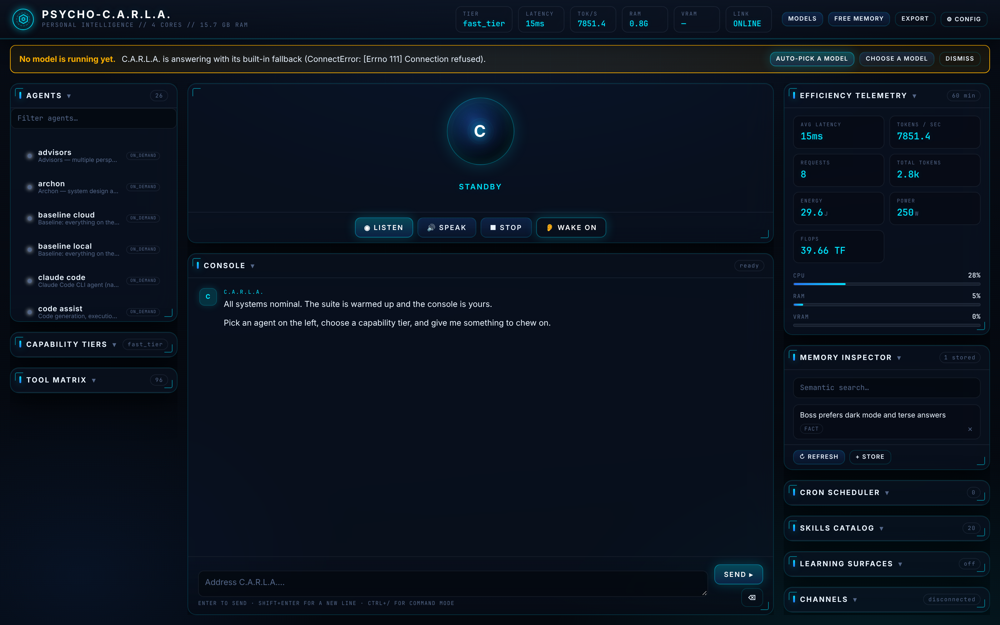

# PSYCHO-C.A.R.L.A.

**C**oding, **A**utomated **R**easoning, & **L**anguage **A**ssistant — a
local-first, model-agnostic personal AI for Windows 11, written from scratch.
An agent framework, a web console (HUD), a desktop shell and CPU-only voice,
in one Python package (`psycho_carla`).



## What you get

- **26 agents**, **96 tools**, 28 knowledge connectors, 32 messaging channels, 20 skills
- **Runs with no model** (built-in offline responder), or with any model:
  built-in CPU engine (ONNX), Ollama, llama.cpp, LM Studio / any OpenAI-compatible
  server, vLLM, a model on **another PC**, or cloud APIs
- **Model Manager**: download, start, stop, delete, *free memory*, custom
  models (any Ollama tag or Hugging Face repo), CPU / GPU (DirectML) switch
- Persistent memory, scheduler, MCP client + server, A2A, workflows, local telemetry
- Voice (optional): Kokoro / Piper TTS, faster-whisper STT, "hey carla" wake word
- Export your conversations, or a fine-tuning dataset, as files that never leave your PC

## Install (Windows 11, Python 3.10+)

```powershell
py -3.11 -m venv .venv
.\.venv\Scripts\Activate.ps1
pip install -e ".[native]"      # core + built-in CPU engine
carla init                      # writes psycho_carla.toml
carla doctor                    # should end with "Ready"
carla serve                     # open http://127.0.0.1:8787
```

Extras: `".[voice]"` voice · `".[native-gpu]"` DirectML GPU (see
[docs/MODELS.md](docs/MODELS.md)) · `".[desktop]"` native window · `".[dev]"` tests.
Or run `.\install.ps1 -Voice`.

## Get a model (pick one)

1. **Easiest:** open the console and click **Auto-pick a model** — it chooses
   the best built-in model that fits your free RAM, downloads and starts it.
2. **Model Manager** (`Models` button): browse the catalog, or type any
   Ollama tag / Hugging Face repo into **Custom model**.
3. **Another PC:** `carla model remote 192.168.1.50 qwen3:8b` points `deep_tier`
   at a stronger machine (e.g. your GPU desktop) on your network.

Everything is also available from the CLI: `carla model --help`.

## Everyday commands

```text
carla chat | ask "…"          talk to it
carla model auto|custom|free|device|remote|list|local
carla export --format markdown|json|training -o out.md
carla agents | tiers | memory | cron | doctor
```

## Configuration

`psycho_carla.toml` — in `%LOCALAPPDATA%\PsychoCarla` (override with
`PSYCHO_CARLA_HOME`). Set `[persona] user_name` for what she calls you
(blank = "Psycho"). Models are *tiers* (`fast_tier`, `deep_tier`, …) you point
at any provider; nothing is hardcoded.

## Tests

```bash
pip install -e ".[dev,native]" && carla init
python -m pytest tests/ -q            # 400+ tests
```

## Status

Code-complete and automatically tested. **Not yet verified:** a real model
answering end-to-end on your hardware, voice, the 32 channels, the desktop
window, and the Windows `.exe` build (`PsychoCARLA.spec`) — these need your PC.
See [PSYCHO.md](PSYCHO.md) and [docs/FEATURES.md](docs/FEATURES.md).

## More

[Models & GPU](docs/MODELS.md) · [Features](docs/FEATURES.md) ·
[Architecture](docs/ARCHITECTURE.md) · [MCP](docs/MCP.md) ·
[Voice](docs/VOICE.md) · [Full reference](docs/REFERENCE.md) ·
[Audits](docs/audits/) · [Technical map for developers/AI: CLAUDE.md](CLAUDE.md)

## License

MIT — see [LICENSE](LICENSE). Original code; OpenJarvis was only a feature checklist.
